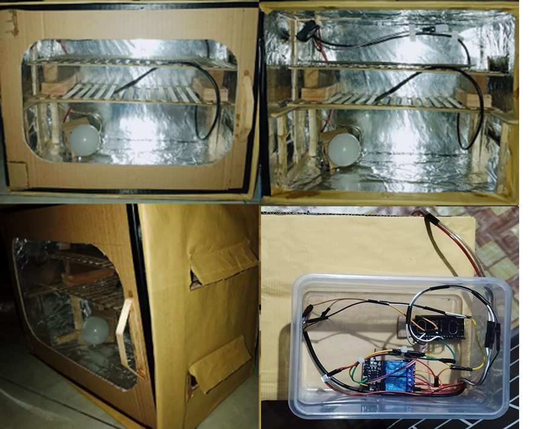
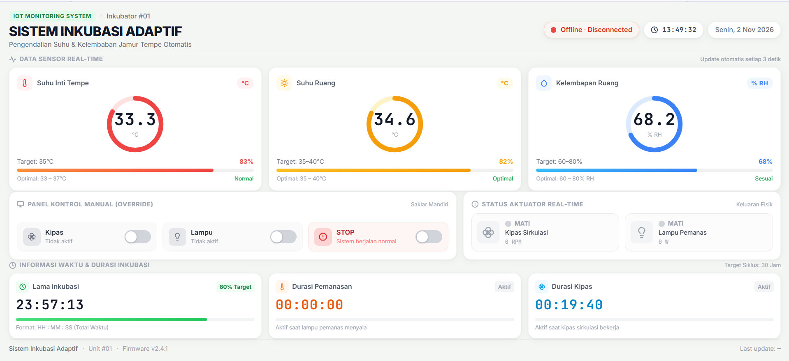
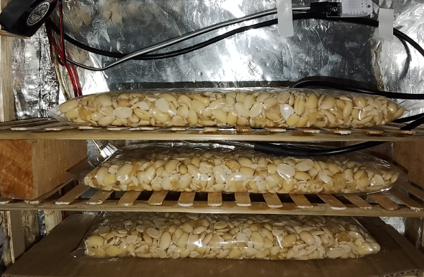
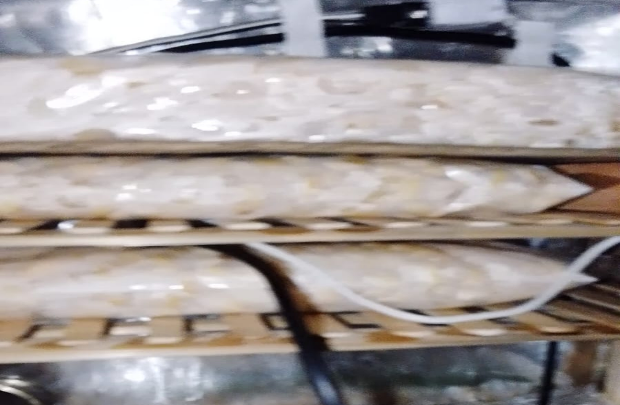
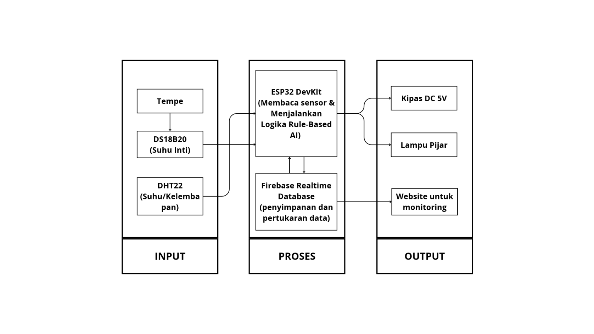
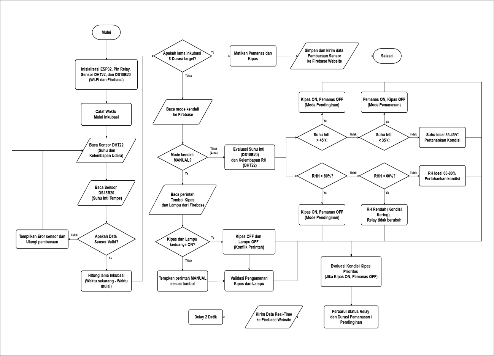
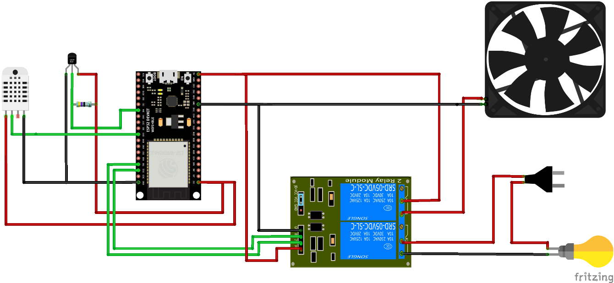

# Sistem Inkubasi Adaptif untuk Pengendalian Suhu dan Kelembapan Jamur Tempe

[](https://www.espressif.com/)
[](https://firebase.google.com/)
[](LICENSE)
[]()

> Prototipe inkubator pintar berbasis Internet of Things (IoT) yang mengoptimalkan proses fermentasi kapang *Rhizopus* pada tempe melalui pengendalian adaptif suhu inti kedelai, suhu ruang, kelembapan, serta integrasi pemantauan dan kendali jarak jauh secara *real-time*.

---

## 👥 Tim Penyusun

**Program Studi S1 Teknik Informatika — Fakultas Ilmu Komputer**  
**Universitas Duta Bangsa Surakarta (2026)**

* **Dosen Pengampu:** Rudi Susanto, M.Si., Ph.D
* **Anggota Pengembang:**
  1. **Erdhika Wondy Agutya** (240103096)
  2. **Faiz Murtadho** (240103097)
  3. **Muchammad Ridho** (240103107)

---

## 📌 Latar Belakang & Overview Project

Tempe merupakan salah satu pangan fermentasi kedelai yang mengandalkan aktivitas kapang *Rhizopus oligosporus / oryzae*. Keberhasilan pembentukan miselium tempe sangat dipengaruhi oleh parameter lingkungan, terutama suhu dan kelembapan udara. Selama proses fermentasi berlangsung, metabolisme aktif kapang menghasilkan panas eksotermik di dalam tumpukan kedelai. Jika panas ini terperangkap dan tidak terkontrol, suhu inti kedelai dapat melonjak melebihi batas toleransi kapang (>45°C), memicu pembusukan atau pertumbuhan bakteri kontaminan.

Sebaliknya, pada skala produksi kecil dan UMKM, inkubasi tempe masih dominan dilakukan secara konvensional dan manual tanpa instrumen ukur presisi. Selain itu, banyak sistem IoT terdahulu hanya mengukur suhu udara ruang tanpa membedakan **suhu inti tempe (*core temperature*)**, padahal suhu inti kedelai adalah indikator biologis utama aktivitas fermentasi.

Untuk mengatasi permasalahan tersebut, proyek ini menghadirkan **Sistem Inkubasi Adaptif Berbasis ESP32** yang memisahkan pengukuran suhu inti tempe (menggunakan sensor *probe waterproof* DS18B20) dan suhu serta kelembapan relatif ruang (menggunakan sensor DHT22). Sistem mengendalikan aktuator pemanas (lampu pijar) dan pendingin/sirkulasi (*exhaust fan*) secara otomatis dengan aturan logika adaptif terhadap tahapan waktu fermentasi (siklus 30 jam) dan dilengkapi mekanisme pengaman *interlock*. Data dan kontrol terhubung secara *real-time* dengan **Firebase Realtime Database** dan **Web Dashboard**.

---

## 📸 Dokumentasi Hardware & Tampilan

| Tampak Prototipe Fisik | Tampilan Web Dashboard |
| :---: | :---: |
|  |  |

| Perbandingan Awal Inkubasi (Jam 0) | Hasil Setelah Inkubasi (Jam 30) |
| :---: | :---: |
|  |  |

---

## ✨ Fitur Utama

1. **Dual-Zone Environmental Monitoring:**
   - **Suhu Inti Tempe:** Dipantau menggunakan probe kedap air DS18B20 yang ditusukkan langsung ke pusat kedelai.
   - **Suhu & Kelembapan Ruang:** Dipantau menggunakan DHT22 untuk mengukur iklim mikro inkubator (rentang ideal 30–35°C dan RH 60–80%).
2. **Pengendalian Adaptif Berbasis Tahapan Waktu & Suhu:**
   - Otomatis menyalakan *exhaust fan* bila suhu inti tempe $\ge 35.0^\circ\text{C}$ untuk membuang panas berlebih.
   - Mengaktifkan lampu pemanas jika suhu inti $< 35.0^\circ\text{C}$ dan durasi fermentasi telah mencapai $\ge 29$ jam (fase akhir pematangan).
3. **Mekanisme Pengaman Hardware (Interlock & Sensor Fail-Safe):**
   - *Mutual Exclusion:* Kipas dan lampu pemanas tidak akan pernah dapat aktif secara bersamaan, baik dalam mode otomatis maupun manual.
   - *Sensor Validation:* Jika salah satu sensor mengalami gangguan (NaN / disconnected), sistem seketika mematikan seluruh aktuator dan beralih ke status darurat `PENGAMAN`.
4. **Cloud Database Dua Arah (Firebase RTDB):**
   - Transmisi telemetri pembacaan sensor dan durasi aktuator diperbarui setiap 2 detik via HTTP PATCH dengan token autentikasi anonim.
   - Eksekusi perintah kontrol manual (*Manual Fan*, *Manual Lamp*, dan tombol darurat *STOP*) dari web dashboard.
5. **Interactive Web Dashboard:**
   - Desain responsif berbasis HTML5, CSS3 kustom, dan Vanilla JavaScript.
   - Dilengkapi *live clock*, status koneksi heartbeat (auto detect offline > 5 detik), visual gauge indikator suhu & kelembapan, stopwatch durasi inkubasi, serta saklar kontrol interaktif.

---

## 🛠️ Arsitektur Sistem & Diagram

### 1. Diagram Blok
Input sensor diproses secara lokal oleh ESP32 untuk menentukan status aktuator relay, sembari menyinkronkan data secara *real-time* ke Firebase Realtime Database dan Web Dashboard.



### 2. Flowchart Logika Pengendalian


### 3. Skema Pengkabelan (Wiring Diagram)


| Komponen | Pin ESP32 | Keterangan |
| :--- | :---: | :--- |
| **DS18B20 (Data)** | `GPIO 4` | Dilengkapi Resistor Pull-Up 4.7 kΩ ke 3.3V |
| **DHT22 (Data)** | `GPIO 18` | VCC ke 3.3V, GND ke GND |
| **Relay IN 1 (Kipas Exhaust)** | `GPIO 23` | Aktif LOW (Relay Module 5V) |
| **Relay IN 2 (Lampu Pemanas)** | `GPIO 22` | Aktif LOW (Relay Module 5V) |
| **Power Supply** | `VIN / 5V` | Adaptor 5V DC untuk ESP32 & Relay |

---

## 📦 Struktur Repositori

```text
├── esp32_iot_tempe/
│   └── esp32_iot_tempe.ino    # Kode program firmware mikrokontroler ESP32
├── frontend/
│   ├── index.html             # Antarmuka web dashboard pemantauan & kontrol
│   ├── style.css              # Styling antarmuka dashboard
│   └── script.js              # Integrasi Firebase JavaScript SDK & live listener
├── docs/
│   └── images/                # Asset gambar skema, foto prototipe, & hasil pengujian
├── database.rules.json        # Aturan keamanan Firebase Realtime Database
├── firebase.json              # Konfigurasi deployment Firebase Hosting
├── .firebaserc                # Konfigurasi project target Firebase
├── .gitignore
└── README.md                  # Dokumentasi teknis proyek
```

---

## 🚀 Panduan Instalasi & Penggunaan

### 1. Prasyarat Perangkat Keras
- 1x ESP32 DevKit C V4
- 1x Sensor DS18B20 Waterproof + Resistor 4.7 kΩ
- 1x Sensor DHT22 (AM2302)
- 1x Modul Relay 2-Channel 5V (Active LOW)
- 1x Kipas Exhaust 5V DC
- 1x Lampu Pijar (5W–15W) + Fitting
- Box inkubator berlapis *aluminium foil*
- Rak bertingkat dari stik kayu / akrilik

### 2. Pengaturan Firmware ESP32
1. Buka file [`esp32_iot_tempe/esp32_iot_tempe.ino`](esp32_iot_tempe/esp32_iot_tempe.ino) di **Arduino IDE**.
2. Pasang pustaka (*libraries*) yang dibutuhkan melalui Library Manager:
   - `DHT sensor library` by Adafruit
   - `Adafruit Unified Sensor`
   - `DallasTemperature` by Miles Burton
   - `OneWire` by Paul Stoffregen
3. Sesuaikan konfigurasi WiFi dan kredensial Firebase:
   ```cpp
   char ssid[] = "NAMA_WIFI_ANDA";
   char pass[] = "PASSWORD_WIFI";
   const char* FIREBASE_HOST = "https://<PROJECT_ID>-default-rtdb.firebaseio.com";
   const char* FIREBASE_API_KEY = "AIzaSy...";
   ```
4. Pilih board **DOIT ESP32 DEVKIT V1** atau **ESP32 Dev Module**, sesuaikan port COM, lalu klik **Upload**.

### 3. Menjalankan Web Dashboard
Dashboard dapat dibuka langsung secara lokal dengan membuka file [`frontend/index.html`](frontend/index.html) pada peramban web modern, atau di-deploy ke Firebase Hosting:
```bash
# Install Firebase CLI (jika belum ada)
npm install -g firebase-tools

# Login Firebase
firebase login

# Deploy hosting
firebase deploy --only hosting
```

---

## 📊 Hasil Pengujian & Analisis

Pengujian prototipe dilakukan selama **30 jam penuh** dengan pengamatan berkala terhadap fermentasi kedelai:

1. **Akurasi Sensor:**
   - Pengujian perbandingan suhu DS18B20 terhadap termometer pembanding menghasilkan rata-rata simpangan hanya **0,1°C – 0,4°C**.
   - Sensor DHT22 menunjukkan respons stabil terhadap perubahan iklim mikro di dalam boks.
2. **Kinerja Pengendalian Adaptif:**
   - Pada jam ke-0 hingga ke-23, suhu inti kedelai berada di kisaran 30°C–34.8°C (fase adaptasi kapang).
   - Pada jam ke-24, suhu inti tempe menembus batas $\ge 35.0^\circ\text{C}$ (tercatat 36,6°C akibat aktivitas metabolisme kapang). Sistem secara otomatis mengaktifkan *exhaust fan* untuk membuang panas berlebih dan menjaga kestabilan lingkungan hingga jam ke-30.
   - Lampu pemanas tetap dinonaktifkan sepanjang pengujian karena suhu inti telah mencukupi kebutuhan fermentasi.
3. **Kualitas Tempe:**
   - Setelah 30 jam, miselium putih *Rhizopus* tumbuh tebal, merata, mengikat seluruh butiran kedelai dengan kompak, dan tidak timbul aroma amonia/pembusukan.
4. **Keandalan IoT:**
   - Seluruh siklus pengujian berhasil terkirim ke Firebase Realtime Database tiap 2 detik tanpa *data loss* signifikan, serta antarmuka web dashboard dapat memvisualisasikan perubahan parameter secara lancar.

---

## 📄 Lisensi

Proyek ini dibuat untuk keperluan akademik dan penelitian Open Source di bawah lisensi [MIT License](LICENSE).
